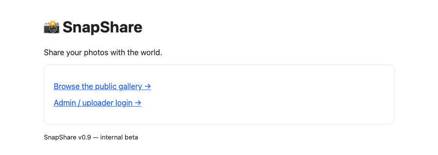
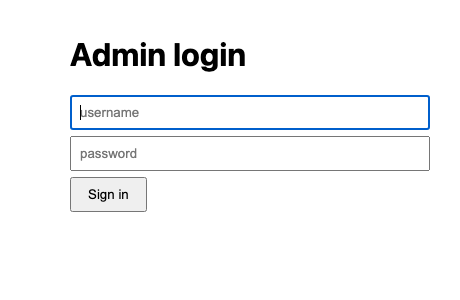

# Pentest Lab — "Uploadry" target

A **deliberately vulnerable** Linux VM for practising basic pentesting skills:
web enumeration → file-upload RCE → credential reuse → `sudo` privilege
escalation to root.

The same target can be obtained in three ways: 
1. import the ready-made **x86 OVA** (any hypervisor, no Mac needed);
2.  build that OVA yourself;
3. run it natively on Apple Silicon with [Lima](https://lima-vm.io). 

Everything is provisioned from the scripts in this repo, so the machine is fully reproducible.

## Screenshots

| Public site | Admin login |
|:---:|:---:|
|  |  |

The intentionally sloppy "SnapShare" photo app 

## Vulnerability class

Modelled on the *weakly-authenticated file-upload → webshell* pattern (same
class as the `php2shell` PoC referenced in the room). No external exploit code
is run; the target simply ships the insecure upload handler so you build the
exploit yourself — which is the point for OSCP.

---

## Getting the VM

### Option 1 — Run locally on Apple Silicon with Lima (fastest to spin up)

Native arm64 VM, port-forwarded to your Mac. Good for quick iteration.

```bash
brew install lima
./lab.sh up        # build & boot the VM, provision the target (first run pulls Ubuntu)
./lab.sh status    # show VM state
./lab.sh reset     # destroy & rebuild clean (fresh flags)
./lab.sh reprovision   # re-run provisioning only, keep the VM
./lab.sh shell     # drop into the VM (admin/debug only — not "cheating")
./lab.sh down      # stop the VM
```

Target web app: **http://127.0.0.1:8080**

### Option 2 — Build a VM image from source

```bash
brew install qemu

# x86-64 OVA
./build/build-x86-ova.sh            # → dist/uploadry.ova

# arm64 VMware Fusion
./build/build-arm64-fusion.sh       # → dist/Progress-Uploadry-arm64.vmwarevm
```

Both scripts re-use `provision/provision.sh` unchanged, so every image is
identical in behaviour.

> **Flags.** This public repo ships **redacted placeholder flags**. To bake real
> ones at build time, export them first:
> ```bash
> USER_FLAG='THM{...}' ROOT_FLAG='THM{...}' ./build/build-x86-ova.sh
> ```
> Without them the provisioner just writes the placeholders.

---

## Requirements

| What you want to do | What you need |
|---------------------|---------------|
| **Run via Lima** (Option 1) | Apple Silicon Mac + `brew install lima` |
| **Build the x86 OVA** (Option 2) | macOS + `brew install qemu` (builds on any Mac; slow under emulation on Apple Silicon) |
| **Build the arm64 Fusion VM** (Option 2) | Apple Silicon Mac + `brew install qemu` + VMware Fusion |

---

## What you'll learn

- **Web enumeration** — `robots.txt`, directory discovery, and spotting a
  leftover source-backup file served as plain text;
- **File-upload exploitation** — defeating an extension **blacklist** plus a
  client-trusted **MIME type** (e.g. with Burp) to land a `.phtml` webshell and
  get RCE;
- **Post-exploitation as `www-data`** — looting on-disk configs and turning a
  cramped webshell into a stable one (dropping an SSH key);
- **Lateral movement** — credential reuse between a DB config and a system user.
- **Linux privilege escalation** — abusing a `sudo` + **GTFOBins** rule
  (`find`) to get root;
- **Persistence** - forging a new ssh key;
- **Fingerprinting to CVE** — mapping a leaked PHP version to a public advisory
  (php2shell, CVE-2026-109618 / CVE-2026-109619);
- **Remediation** — how each weakness should have been prevented.

## Objectives

1. Enumerate the web app. Find the admin area and a way in.
2. Get code execution on the box (`www-data`) through the uploader.
3. Find credentials on disk and move laterally to a real user.
4. Escalate to **root**.
5. Collect both flags: `/home/michael/user.txt` and `/root/root.txt`.

## Attacking it realistically (Kali vs. target)

For a setup where the target has its own IP and you attack from a
**Kali VM**:

- **Lima (Option 1):** the app is port-forwarded to `127.0.0.1:8080`, so you can
  run your tools (Burp, `ffuf`, `curl`, a webshell) straight from the Mac. For a
  dedicated IP, add a shared network to `lima/uploadry.yaml`:
  ```yaml
  networks:
    - lima: shared     # needs: brew install socket_vmnet  (+ sudoers entry, see lima docs)
  ```
- **arm64 Fusion VM (Option 2):** boots in VMware Fusion with its own NAT IP —
  attack it from a Kali VM on the same Fusion network.

## Files

```
oscp-lab/
├── lab.sh                   # up / down / reset / shell helper (Lima)
├── lima/uploadry.yaml       # the Lima VM definition (arm64)
├── provision/provision.sh   # builds the target (shared by every build path)
├── webapp/                  # the vulnerable SnapShare app
└── build/
    ├── build-x86-ova.sh      # → dist/uploadry.ova  (cross-platform / THM)
    └── build-arm64-fusion.sh # → dist/…vmwarevm     (Apple Silicon local lab)
```
